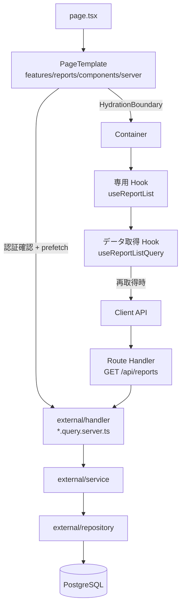
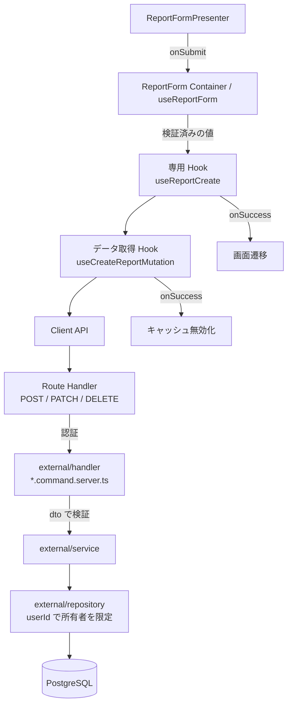

# アーキテクチャ設計

設計方針の正は [../../docs/architecture.md](../../docs/architecture.md) です。本ドキュメントでは、レイヤー間のつながりとデータの流れを補足します。

## 全体構成

```
frontend/src/
├─ app/          # App Router（ルーティングのみ。薄く保つ）
│  └─ api/       # Route Handlers（HTTP の入出力のみ）
├─ features/     # 機能のページ群でしか使わないもの
│  └─ {feature}/
│     ├─ components/
│     │  ├─ server/  # PageTemplate（Server Components）
│     │  └─ client/  # Container / Presenter / 専用 Hook（コンポーネント単位）
│     ├─ hooks/      # Feature 内で共有する useQuery / useMutation
│     ├─ queries/    # クエリキー
│     ├─ api/        # fetch による Route Handler 呼び出し
│     └─ servers/    # サーバー専用の関数（auth の認証ガードなど）
├─ shared/       # 複数の Feature で使うもの
│  ├─ components/ui/ # shadcn/ui などの汎用 UI
│  ├─ lib/           # QueryClient・Better Auth 設定など
│  ├─ hooks/         # 汎用 Hook
│  └─ providers/     # QueryClientProvider など
└─ external/     # 外部連携層（DB・外部 API との境界）
   ├─ client/      # DB 接続・HTTP クライアント
   ├─ domain/      # entity
   ├─ dto/         # 入出力の契約（Zod）
   ├─ handler/     # external の入口（Query / Command）
   ├─ repository/  # DB アクセス
   └─ service/     # 業務ロジック・接続先の選択
```

ディレクトリは必要になった段階で追加し、空ディレクトリを先行して作らないでください。

### features と shared の使い分け

| 置き場所 | 判断基準 |
| --- | --- |
| `features/{feature}/` | その機能のページ群でしか使わない |
| `shared/` | 2 つ以上の Feature で使う |

最初は `features/` に置き、必要になった時点で `shared/` へ移動します（[04_features_structure.md](./04_features_structure.md)）。

## 設計原則

1. **Feature-Based**: ページ群専用のものは機能単位でひとまとめにする
2. **Server / Client の分離**: サーバー専用処理をクライアントバンドルに含めない
3. **Container / Presenter**: 状態・副作用と描画を分け、1 コンポーネント 1 ディレクトリにまとめる
4. **外部接続の分離**: DB・外部 API とのやり取りは `external/` に閉じ込める
5. **接続先の切り替えは service だけ**: Go 移行時に DB → API へ切り替えても、service 以外を変更しない

いずれも MVP の単純さを優先し、必要以上の抽象化はしません。

## レイヤーの責務

| レイヤー | 配置 | 責務 | してはいけないこと |
| --- | --- | --- | --- |
| Page / Layout | `app/**/page.tsx` | パラメータ受け取り、PageTemplate の呼び出し、Metadata | 業務ロジック・DB アクセス・複雑な UI |
| Route Handler | `app/api/**/route.ts` | 認証確認、JSON 解析、handler 呼び出し、ステータスコード変換 | 業務ロジック・service / repository の直接呼び出し |
| PageTemplate | `features/*/components/server/` | 認証確認、handler による初期データ取得、Container への受け渡し | Hooks の利用、service / repository の直接呼び出し |
| Container | `features/*/components/client/Xxx/` | 専用 Hook を呼び、Presenter に Props を渡す | DOM の描画 |
| Presenter | `features/*/components/client/Xxx/` | Props を受け取って描画、操作をコールバックで通知 | 状態・副作用・API 通信・業務ロジック |
| 専用 Hook | `features/*/components/client/Xxx/useXxx.ts` | データ取得、イベントハンドラ、画面遷移 | 描画 |
| データ取得 Hook | `features/*/hooks/` | `useQuery` / `useMutation` とキャッシュ無効化 | 画面遷移など画面固有の処理 |
| Client API | `features/*/api/` | `fetch` による Route Handler 呼び出し | UI の状態管理 |
| External | `external/` | 入力検証・業務ロジック・DB / API アクセス・レスポンス変換 | UI・HTTP（`Request` / `Response`）への依存 |

`external/` 内部の責務は [05_external_layer.md](./05_external_layer.md) を参照してください。

## データフロー

### 読み取り（一覧・詳細）

初期表示は PageTemplate から handler を直接呼び出し、TanStack Query のキャッシュへプリフェッチします。自分自身の Route Handler を Server Component から `fetch` しないでください。



### 書き込み（作成・編集・削除）



書き込みは Route Handler（REST API）に統一し、Server Actions は使用しません。API 契約（`external/dto`）を Go 移行後も維持するためです。

### Go 移行後

`external/service` の呼び出し先だけが変わります（[05_external_layer.md](./05_external_layer.md#go-移行時の変更)）。

```
handler ──▶ service ──▶ repository ──▶ PostgreSQL     【MVP】
handler ──▶ service ──▶ client/api ──▶ Go API         【移行後】
```

## 依存関係のルール

```
app/page.tsx ──▶ features/*/components/server（PageTemplate）
                        ├──▶ features/*/components/client（index.ts 経由）
                        └──▶ external/handler
app/api/route.ts ─────────▶ external/handler
features/*/components/client ──▶ features/*/hooks ──▶ features/*/api
features/* ───────────────▶ shared/, external/dto（スキーマ・型のみ）
external/handler ──▶ service ──▶ repository ──▶ client/database
```

- features / app から `external/service` / `repository` / `client` を import しない（入口は `handler` のみ）。
- Client Component から import してよい external のファイルは `dto` だけ。
- `external/` から `features/` / `app/` を import しない。
- `shared/` から `features/` を import しない。
- Feature 間の依存は避ける。2 つの Feature で必要になったものは `shared/` へ移動する。
- 他のディレクトリのコンポーネントは `index.ts` 経由で import し、Presenter を直接 import しない。
- サーバー専用ファイルには `import "server-only";` を付け、Client Component からの誤 import をビルド時に検出する。

## 未決定事項・要対応

- `components.json` の `aliases`（`@/components/ui`, `@/lib/utils` など）が `src/shared/` 配下を指していません。`npx shadcn add` の生成先を揃えるため、`@/shared/components/ui` などに変更が必要です。
- `src/lib/utils.ts` は `cn` を `"cn"` から再エクスポートしています。shadcn/ui の標準（`clsx` + `tailwind-merge`）とは異なるため、動作確認が必要です。配置も `src/shared/lib/utils.ts` に揃えてください。
